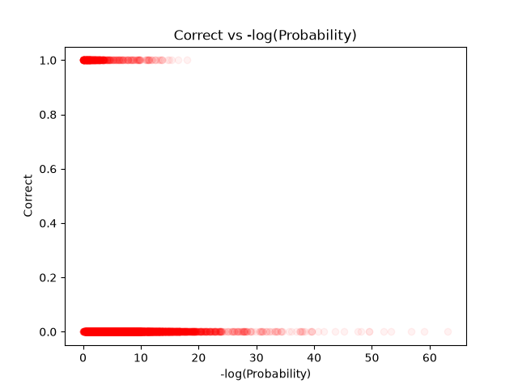
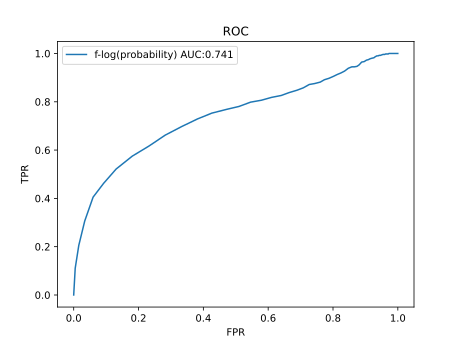
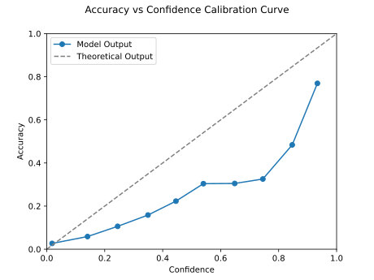
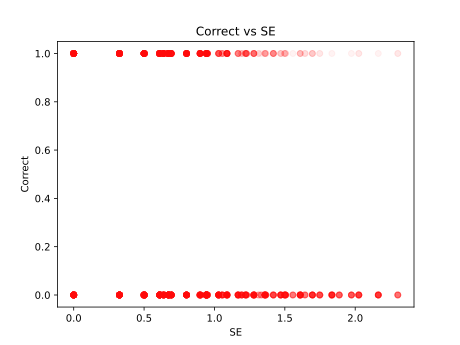
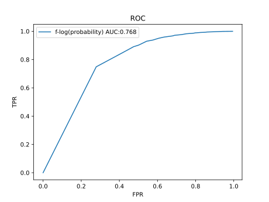

# Detecting When a Small LLM Is Probably Wrong

Can we tell, without a ground-truth answer, whether a language model is about to give a wrong answer? This project compares two black-box/grey-box uncertainty signals on **Llama-3.2-1B-Instruct** answering **SQuAD** questions:

1. **Sequence confidence**, the product of the top-token probabilities over the generated answer.
2. **Semantic entropy (SE)**, the entropy over *meanings* of 10 sampled answers, clustered with an NLI model.

Each signal is scored by how well it separates correct answers from incorrect ones (AUROC) and, for confidence, how well calibrated it is.

## Results

| Signal | AUROC | Notes |
|---|---|---|
| Sequence confidence (`-log(confidence)`) | **0.741** | Single sample, 10,000 questions |
| Semantic entropy | **0.768** | 10 samples per question, 10,000 questions |

Semantic entropy is modestly better at flagging likely-wrong answers, at roughly 10x the generation cost plus an NLI pass.

### Confidence

| Correctness vs. `-log(p)` | ROC |
|---|---|
|  |  |

Correct answers (y = 1) cluster at low `-log(p)` (high confidence), while incorrect answers (y = 0) have a long tail out to very low probability. Points are drawn with low alpha, so darker means denser.

**Calibration.** Accuracy rises monotonically with confidence, but the model is **overconfident** almost everywhere: the curve sits below the diagonal. For example, answers in the highest confidence bin (about 0.93) are correct only about 77% of the time, and answers around 0.85 confidence are correct about 48% of the time.



### Semantic entropy

| Correctness vs. SE | ROC |
|---|---|
|  |  |

SE takes only a handful of discrete values (determined by how the 10 samples split into clusters), so the ROC curve is coarser and more stepped than the confidence one.

## Method

**Model and data**
- Model: `meta-llama/Llama-3.2-1B-Instruct` (bfloat16, one GPU).
- Data: first 10,000 questions of the SQuAD v1.1 train split (1,000 batches of 10), prompted with the context plus question.
- System prompt: *"Answer in as few words as possible. Output only the entity name and nothing else."*
- Decoding: sampling, temperature 0.7, max 100 new tokens.

**Correctness label**
- SQuAD v1.1 official normalisation (lowercase, strip punctuation and articles) and token-level F1 against the first reference answer.
- An answer is *correct* if F1 > 0.5.

**Signal 1: sequence confidence**
- For each generated sequence, take the highest softmax probability at each of the last 50 decoding steps and multiply them.
- The uncertainty score is `-log(confidence)`.

**Signal 2: semantic entropy**
1. Sample 10 answers per question (same prompt and decoding settings).
2. For every ordered pair of answers, run `microsoft/deberta-large-mnli` and mark `ENTAILMENT` as a directed edge.
3. Group answers into semantic clusters as the strongly connected components of that graph (mutual entailment).
4. Compute `SE = -sum_c p_c * log(p_c)`, where `p_c` is the fraction of the 10 samples in cluster `c`.
- For SE, a question is labelled correct if the **mean F1 across the 10 samples** is above 0.5.

**Evaluation**
- ROC: sweep 200 thresholds on the uncertainty score; "positive" = correct answer, kept when its score is below the threshold. AUROC via `sklearn.metrics.auc`.
- Calibration: 10 equal-width confidence bins, plotting mean confidence against mean accuracy.
- The best-threshold accuracy (maximising TPR - FPR) is also printed by the script.

## Repository layout

```
.
├── main.ipynb / main.py        # full pipeline (generation, confidence, SE, plots)
├── figures/
│   ├── dot_confidence.png
│   ├── calibration_curve.svg
│   ├── auroc_confidence.svg
│   ├── dot_semantic_entropy.svg
│   └── auroc_semantic_entropy.svg
├── .env                        # HFToken=<your Hugging Face token> (not committed)
└── README.md
```

## Running it

```bash
pip install torch transformers datasets scikit-learn scipy matplotlib python-dotenv huggingface_hub
echo "HFToken=hf_xxx" > .env   # needs access to the gated Llama 3.2 weights
```

Then run the script top to bottom. You need a CUDA GPU; the confidence run is 1,000 batches of 10, and the SE run repeats that 10 times, so expect it to take a while. The NLI step scores 90 ordered pairs per question (900,000 pairs for 10,000 questions) and is the slowest part of the SE pipeline.

## Limitations and notes

- **Different labels.** The confidence run labels a question using a single sampled answer; the SE run uses the mean F1 over 10 samples. The two AUROCs are therefore on slightly different targets and are not a perfectly controlled comparison.
- **Confidence window.** The score uses the last 50 decoding steps of the batch. In a batch, sequences that finish early are padded with EOS, so for short answers this window includes padding steps and is not strictly "the answer tokens". Restricting to each sequence's real generated tokens, and using the probability of the token actually sampled, would be a cleaner definition.
- **Temperature.** The stored scores are temperature-adjusted (T = 0.7), which sharpens the distribution and likely adds to the overconfidence seen in the calibration plot.
- **Threshold choice.** F1 > 0.5 is one reasonable cut-off; results will shift with a different threshold or with multiple references per question.
- **Small model, extractive task.** SQuAD gives the model the context, so most questions are answerable and wrong answers are the minority class. A harder closed-book set (e.g. TriviaQA) would be a useful follow-up.
- **Single run.** No seeds or confidence intervals on AUROC yet.

## Ideas for next steps

- Bootstrap confidence intervals on both AUROCs.
- Combine confidence and SE (e.g. logistic regression) and test whether they carry complementary information.
- Use token-length-normalised log-probability and the sampled-token probability.
- Try closed-book QA and larger models.
- Wrap the best signal in a lightweight tool or browser extension that flags likely-wrong answers.

## References

- Rajpurkar et al., *SQuAD: 100,000+ Questions for Machine Comprehension of Text* (2016).
- Kuhn, Gal, Farquhar, *Semantic Uncertainty: Linguistic Invariances for Uncertainty Estimation in Natural Language Generation* (ICLR 2023).
- Farquhar et al., *Detecting hallucinations in large language models using semantic entropy* (Nature, 2024).
- Williams, Nangia, Bowman, *A Broad-Coverage Challenge Corpus for Sentence Understanding through Inference* (MNLI), and He et al., *DeBERTa* (2021).
